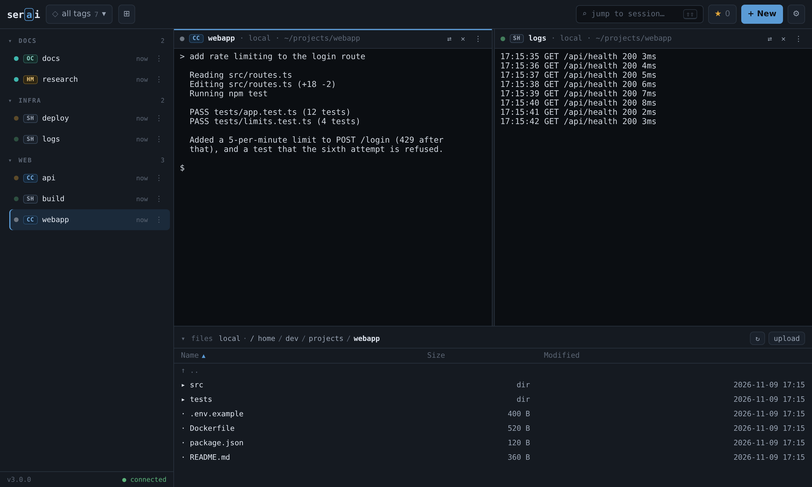
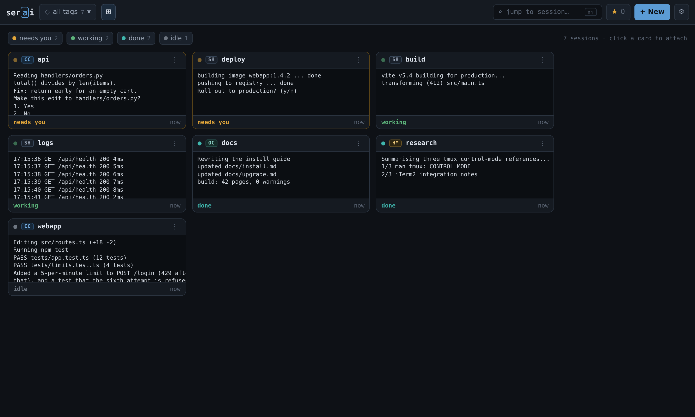
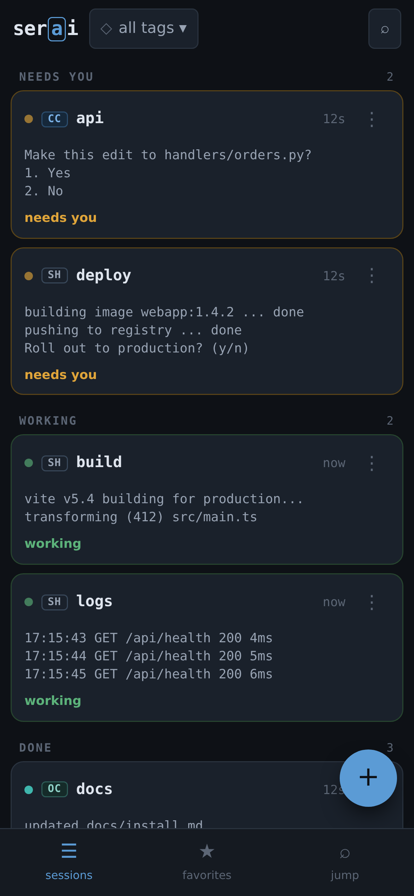
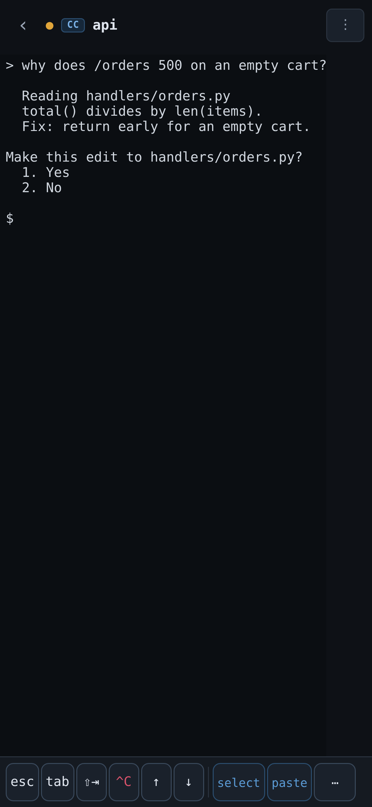

# serai

[](https://github.com/preston-peterson/serai/actions/workflows/ci.yml)
[](LICENSE)

A single attach point for your terminal and your coding agents — Claude, Grok,
OpenCode, and Hermes — across the local machine and remote hosts, backed by tmux
for persistence.

When you run a dozen agents at once, the hard question stops being "where is my
terminal" and becomes **"which of these needs me right now?"** serai answers that
in the corner of your eye: a rail of every session sits beside your terminals,
each row carrying a dot for what that session is actually doing, and a board
overview shows them all at once with a few lines of live output on each card.

It holds **none of your fleet's credentials** — remote work goes through your
ssh-agent, and tmux keeps every session alive when you close the tab.



## What it does

**The attached view** is where you work. The rail on the left lists every
session, grouped by tag, each with its state dot; click one to attach it. Up to
**two panes** sit side by side (Shift+click a row, or **⋮ → Open in second
pane**, for the second), with a divider you can drag; the rail's edge drags too.
The **files drawer** underneath follows whichever pane has focus, opening on that
session's host and directory.

**The board** (⊞ in the top bar) is the overview: one card per session with a
live tail of its pane, sorted so whatever needs you comes first, with a chip per
state to filter by. Click a card to attach. serai remembers which view you left
it on.



Every session reads as one of five states:

| | meaning | how it's detected |
|---|---|---|
| **working** | busy right now | an agent whose status line says a turn is running (Claude, OpenCode, Hermes), a shell with a non-shell process in the foreground, or fresh output |
| **needs you** | waiting on you | a prompt marker in the pane tail — a permission ask, `[sudo] password`, `(y/n)` |
| **looping** | stuck | an agent repeating the same line in the pane tail, or holding an unchanged view across several polls while claiming to work (never a shell, and never a real `(y/n)`) |
| **done** | finished, unread | a coding-agent session parked back at its prompt after recent activity, that you haven't opened |
| **idle** | at rest | a shell at its prompt, or an agent dormant a while past the done window |

Detection is a heuristic, and deliberately a cheap one: it reuses the pane capture
already taken for the preview plus two fields tmux hands over for free, so a large
fleet costs no extra round trips. See [Tuning](#tuning) to adjust the windows.

- **Terminals** speak to tmux in its *control mode* (`tmux -C`), the way iTerm2
  does: tmux streams each pane's own output to the browser rather than drawing a
  screen for it. So the browser terminal holds the pane's real scrollback, and
  selection, scrolling, and the clipboard behave like a local terminal's — in a
  shell and inside an agent's full-screen UI alike. A dropped connection
  reattaches by itself, because tmux kept the session alive.
- **Exiting a coding agent drops you to the prompt, it doesn't close the
  session.** `/exit` (or quitting opencode / Grok / Hermes) leaves the session
  alive at a shell prompt, and the pane offers **▶ Relaunch** to start the agent
  again with its saved resume choice and args — or use the session as a plain
  shell. It stays on the board as *done* in the meantime.
- **Files** browses any host — local filesystem or SFTP — with cut/copy/paste,
  rename, delete, new folder, multi-select, and drag-and-drop upload. Copying
  between two hosts relays as a streamed tar, so a multi-GB tree moves at a fixed
  memory cost and reports bytes as it goes.
- **Jump** (Ctrl+Shift+P, or double-tap Shift) fuzzy-finds any session by name or
  tag, running or saved, and offers to create one if nothing matches.

## Copy and paste

| | |
|---|---|
| **select** | drag; double-click for a word, triple-click for a line, Shift+click to extend. When an app has turned on mouse reporting, a plain drag goes to the app — Shift+drag still selects. |
| **copy** | Ctrl+Shift+C, Ctrl+Insert, or Cmd+C — and **Ctrl+C when something is selected**. With nothing selected, Ctrl+C is the usual interrupt. |
| **paste** | Ctrl+V, Ctrl+Shift+V, Shift+Insert, or Cmd+V. Sent exactly once, as typed text. |
| **menu** | right-click for copy / paste / select all (Shift+right-click when an app has the mouse). |

Selection works over the whole scrollback, not just the screen, so a long answer
from an agent copies in one go. Apps can also set the clipboard themselves (OSC
52). Copy-on-select and bracketed paste are both off by default and live in ⚙.

## Workspaces are your tags

Tag a session and it groups by that tag — in the rail, and in the workspace picker
in the top bar. Filtering to a tag narrows the board and the rail together, which
is how you carve a couple of dozen sessions into projects.

Tags live on the tmux session itself (a `@serai_tags` user option), so they
persist for the session's lifetime with no external store.

The host list is your `~/.ssh/config`: serai keeps no host database of its own.

## The session model

Every session is `where × what × persistence`. serai creates a missing session
detached, then attaches a control-mode client to it:

| | creates (only if missing) | attaches |
|---|---|---|
| local shell | `tmux new -d -s shell-main` | `tmux -C attach -t =shell-main` |
| local agent | `tmux new -d -s cc-webapp '… cd ~/projects/webapp && claude …'` | `tmux -C attach -t =cc-webapp` |
| remote shell | `ssh web-01 'tmux new -d -s shell-deploy'` | `ssh web-01 'tmux -C attach -t =shell-deploy'` |
| remote agent | `ssh web-01 'tmux new -d -s cc-api …'` | `ssh web-01 'tmux -C attach -t =cc-api'` |

The agent rows show Claude; Grok, OpenCode, and Hermes run the same way with their
own command and prefix. An agent runs inside a shell, which is why exiting it
leaves you at a prompt. Remote panes on the same host share one ssh connection
(OpenSSH connection sharing); `SERAI_SSH_MUX=0` turns that off.

Naming tells serai what a session is:

- `cc-<project>` or `<project>-claude` → Claude Code
- `grok-<name>` → Grok Build
- `oc-<name>` → OpenCode
- `hm-<name>` → Hermes
- `shell-<name>` or `<name>-term` → a plain shell

The suffix forms are recognised so sessions you created outside serai are picked
up as-is, rather than needing a rename.

**+ New** (Ctrl+Shift+N) and **⋮ → Edit session…** are the same form: host, kind,
label, directory, launch, args, tags, and a favorite checkbox.

**Directory** — give a session a directory and both the terminal and the file
browser open there. It's stored on the session, so it survives you `cd`-ing
elsewhere and is reused whenever the session is started again.

**Launch** — for an agent: start a *new* conversation, *continue* the last one, or
open the agent's *resume picker* to choose. It's remembered with the session and
used whenever serai starts the agent again (restore, restart, relaunch).

**Args** — a coding-agent session can carry extra arguments for its own command
(Claude's `--chrome`, `--model opus`, whatever you need). They're remembered with
the session, including across a reboot. They're split into arguments and quoted
individually before they reach the command, so nothing you type there can run as
a shell command. A resume flag in the args wins over the launch choice.

Directory and args take effect when a session is *created* — tmux won't re-run a
command for a session that already exists — so changing them on a running session
needs a restart: **Save & restart** in the edit form (on a phone, **⋮ →
Restart…**). That kills and recreates the session, so anything running in it is
lost; the form says so before you press it.

**Saved profiles.** Creating a session remembers how to start it (host, kind,
label, directory, launch, tags, extra args). That profile survives `/exit` and a
reboot. **⋮ → Close session…** ends the tmux session and forgets the profile, so
it won't be offered again. A **favorite** is the exception: closing it keeps the
profile, since a favorite is something you launch again. **Forget profile…** in
the edit form (or the ★ panel's ⋮) forgets one outright.

**Resume is on demand**, not a banner and not a card in front of live work.
**Jump** lists saved-but-not-running profiles under the live ones; picking one
starts it again with its launch choice. **+ New** with a matching label fills in
the rest of the form from the profile. The board and rail only show what's
running.

**Favorites** mark the profiles you want one-click restore for. Tick **favorite**
in the form, or use **⋮ → Add to favorites** on a rail row, and the session joins
the **★** panel in the top bar: a table you can drag to reorder, where one click
attaches a running favorite or restores one that isn't. Its ⋮ removes a favorite
or forgets it. A favorite is just a saved profile with a flag, so it follows the
same ownership rules, and it survives closing its session — it's a launcher, not a
bookmark on a running session.

## Keyboard

| | |
|---|---|
| Ctrl+Shift+P, Shift Shift | jump to a session (Ctrl+K too, outside a terminal) |
| Ctrl+Shift+N | new session |
| Ctrl+Shift+1 / 2 | focus the first / second pane |
| ↑ ↓ Enter in the rail | move and attach; Shift+Enter opens in the second pane |
| Shift+F10 or the menu key | a rail row's ⋮ menu |
| Esc | closes any dialog or menu |

**⚙ Settings** applies as you change it and follows you between devices:
terminal font, size, cursor, scrollback, copy-on-select, and bracketed paste;
the terminal palette and rail density; and the update check.

## On a phone

Laid out for triage and short replies rather than as a shrunken desktop. The
session list is grouped by state with each session's last lines inline, so you
can see what needs you without opening anything; favorites and jump sit in the
bottom bar.

Tap a session for a full-screen terminal that resizes around the keyboard, with
a key bar for the keys a soft keyboard doesn't have — `esc`, `tab`, `⇧⇥`
(Shift+Tab, to cycle an agent's mode), `^C`, `↑` `↓`, and **⋯** for the rest
(`←` `→` `|` `~` `/` `^D` `^Z` `^L` `^R`). **select** lays the recent output
out as plain text so your phone's own selection handles and Copy work; **paste**
pastes. Scrolling is the phone's own, momentum included. The **⋮** sheet has
the session's actions and its files.

<p>
  
  
</p>

## Run it

```bash
./run.sh                 # https://127.0.0.1:8022 (self-signed cert)
SERAI_PORT=9000 ./run.sh
```

serai serves **HTTPS by default**. On first run it generates a self-signed cert
under `~/.config/serai/`; your browser will warn it's untrusted — accept it once.
To use your own cert:

```bash
SERAI_CERT=/etc/ssl/serai.crt SERAI_KEY=/etc/ssl/serai.key ./run.sh
SERAI_TLS=off ./run.sh    # plain http: localhost only, or behind a TLS proxy
```

To reach serai from the LAN, bind beyond localhost and make sure the cert covers
the name you'll use:

```bash
SERAI_HOST=0.0.0.0 SERAI_HOSTNAME=serai.home.example ./run.sh
```

Requirements: **tmux 3.2 or newer** locally and on any remote host you attach to
(serai uses control-mode flow control, which arrived in 3.2), plus `ssh` for
remote hosts. Keys come from your ssh-agent (`ssh-add -l` to check). Python ≥3.10. The web UI
(xterm.js) is vendored, so nothing is fetched at runtime.

## Run as a service

One line on a fresh box:

```bash
bash <(curl -fsSL https://raw.githubusercontent.com/preston-peterson/serai/main/get.sh)
```

That checks the machine can run serai, downloads the latest release, **verifies
it against the release's published sha256** — refusing to continue if it doesn't
match — and hands off to the installer. Any flags go straight through, e.g.
`bash <(curl -fsSL …/get.sh) --hostname serai.lan --system`.

Or from a clone:

```bash
./install.sh                                 # interactive: asks how you'll reach serai
./install.sh --hostname serai.lan,192.0.2.5  # or set it up front
./install.sh --system                        # system unit (sudo) instead of a user unit
```

The installer **copies the app out of your checkout** to `~/.local/share/serai`
and runs the service from there, so your working tree is only the source — dev
notes and `.git` never reach the runtime. It writes an editable env file at
`~/.config/serai/serai.env`, installs the unit, and enables it (a user service by
default, lingering so it starts at boot).

Re-running it updates in place, and **only restarts when backend code changed** —
a frontend-only update deploys without dropping a single attached session.

**Coming from 2.x?** Update the same way — re-run the installer, or **Update now**.
Sessions, saved profiles, favorites, accounts and your terminal settings carry
over, and open terminals reconnect on their own. Check `tmux -V` on your remote
hosts first: serai 3 needs tmux 3.2 or newer there too.

```bash
systemctl --user status serai
journalctl --user -u serai -f        # logs, incl. the first-run setup code
```

Preview either script with `--dry-run`. To remove serai, `./uninstall.sh` (keeps
your config and credentials; `--purge` removes those too). Your tmux sessions are
never touched.

serai can tell you when a newer release exists: a dot appears on the ⚙ button,
and the panel links to the release notes. Pick the cadence there — daily, weekly
(default), monthly, or never. The check runs on the server once per instance and
is cached, so open tabs cost nothing, and it fails quietly offline. It is the
only outbound request serai makes; `SERAI_UPDATE_CHECK=off` disables it.

When one is available, an admin gets an **Update now** button that downloads the
release, verifies its sha256, installs it, and restarts — your terminals
reconnect on their own because tmux keeps them. It's the same download-verify-
install path as the one-liner, run from the UI. (Offered only when serai runs as
a systemd service; from a clone you'd `git pull && ./install.sh`.)

An admin can change the listen address and certificate hostnames later from the
web UI — account menu → **Network** — without re-running the installer.

## Logging in

serai is a single attach point into your whole fleet, so it ships with a login.
On a fresh install the **first person to open it creates the admin account**; from
then on everyone signs in, and admins manage users from the account menu. Set it
up promptly — until that first account exists, anyone who can reach serai could
claim it.

If that window worries you, `SERAI_SETUP_CODE=1` makes the first-run screen
require a one-time code printed to the service log, so only someone with shell
access can create the admin.

**Sessions belong to whoever created them.** You see your own; admins see all of
them, and **⚙ → Appearance → Show owner chips** marks whose is whose on every
rail row. Attaching, closing, renaming, restarting and relaunching all refuse
someone else's session, not just the board and the rail — a session name is easy
to guess. Ownership lives on the session (`@serai_owner`), so it survives a
restart and a later resume from a saved profile. Sessions with no recorded owner — made outside
serai, or before this existed — are visible to admins only, so an existing fleet
doesn't land on a new user's board.

> **This is organisational separation, not a sandbox.** Every session runs as
> serai's own OS user, so anyone who can open a shell in serai can reach every
> session on the host regardless, and the file browser is not scoped at all.
> Give accounts to people you'd already trust with a shell on that machine.

Passwords are stored only as **scrypt hashes** in `~/.config/serai/users.json`;
sessions are HMAC-signed, httpOnly cookies. Locked out? `python -m serai.auth add
<user> --admin` works from the host shell. For a trusted localhost, `SERAI_AUTH=off`.

## Security notes

- Binds to `127.0.0.1` by default and serves HTTPS, so the login isn't sent in the
  clear on your network. The login and TLS are **defence in depth**, not a reason
  to expose it — still front serai with a reverse proxy, VPN, or LAN bind.
- **Stores no remote credentials**: no host list, no ssh keys, no remote passwords.
  The ssh config is read-only, sessions live in tmux, and transfers use your
  agent-authenticated SSH. The only secret it keeps is its **own** login.
- Host aliases, session names, and paths are treated as hostile input and never
  interpolated into a shell string — every command is built as an argv list.

## Tuning

Everything below is optional; the defaults are sensible.

| variable | does |
|---|---|
| `SERAI_HOST` / `SERAI_PORT` | listen address (default `127.0.0.1:8022`) |
| `SERAI_TLS` / `SERAI_CERT` / `SERAI_KEY` / `SERAI_HOSTNAME` | TLS and the names the generated cert covers |
| `SERAI_AUTH` / `SERAI_SETUP_CODE` / `SERAI_SESSION_TTL` | login behaviour |
| `SERAI_WORKING_WINDOW` | seconds of quiet before a shell stops reading as *working* (20) |
| `SERAI_DONE_WINDOW` | how long a finished agent session shows as *done* (1800) |
| `SERAI_WAIT_MARKERS` (plus per-kind `_CLAUDE`, `_GROK`, `_OPENCODE`, `_HERMES`, `_SHELL`) | extra phrases that mean "needs you", comma-separated |
| `SERAI_STUCK_DUPES` | consecutive identical lines in one pane capture before an agent reads as *looping* (3) |
| `SERAI_STUCK_POLLS` | consecutive unchanged pane captures before an agent reads as *looping* (3) |
| `SERAI_TMUX_CACHE_TTL` | how long remote session discovery is cached (3s) |
| `SERAI_SSH_MUX` | `0` gives each remote pane its own ssh connection instead of sharing one per host |
| `SERAI_UPDATE_CHECK` | `off` disables the update check entirely (it's the only outbound call serai makes) |
| `SERAI_UPDATE_REPO` | which repo the update check asks about, `owner/name` — for forks |
| `SERAI_CONFIG_DIR` | where config, credentials, and the cert live |
| `SERAI_SKIP_PATH_PROBE` | `1` stops serai asking your login shell for its PATH at startup (see below) |

**About that PATH probe.** tmux gives a new session the environment of whatever
created it — which is serai — so serai's `PATH` is the `PATH` your sessions run
under. As a boot-time service it can start before your desktop session has
published the `PATH` you'd get in a terminal, and then tools in `~/.local/bin`
(`claude` among them) aren't found. So at startup serai asks your login shell
what its `PATH` is and adopts it. It's best-effort: if the shell fails, hangs, or
answers with something that isn't a `PATH`, serai keeps the one it had.

## Known rough edges

- **"needs you" is a heuristic.** It scans the last few non-blank lines of the
  visible pane, so a session genuinely waiting can read as idle if its prompt has
  scrolled or reflowed out of that window. Widening the window would trade this
  for stale-prompt false positives. Extend the markers with the env vars above.
- **Downloads are buffered in the page.** A file is fetched into browser memory
  before it's saved, so serai warns before very large ones. This is a consequence
  of the self-signed certificate — browsers refuse ordinary downloads from an
  origin with a certificate error.
- **A cross-host folder copy has no progress bar**, only a running byte count —
  a tar stream doesn't know its own size, so there's no honest denominator.
- **Grok can't show *working*.** Claude, OpenCode and Hermes print a marker while
  a turn runs; Grok has none serai can read, so a busy Grok session shows *done*.
- **Bracketed paste, when you turn it on, can miss an app that enabled it before
  you attached.** tmux doesn't report that mode, so serai can't restore it, and
  such a paste arrives unbracketed until the app sets it again. The setting is
  off by default, and the default paste is unaffected.

## License

MIT — see [LICENSE](LICENSE).
